# ctz-interval

Intervals drawn on a number line, for French maths teaching, after Cédric
Pierquet's LaTeX package [ProfLycee](https://ctan.org/pkg/proflycee): open or
closed bounds, infinite bounds, background, zigzag or hatching decoration. The
commands, their keys and this README are in French.

Ce paquet sert pour la représentation d'intervalle(s). Je me suis basé sur le paquet LaTeX
[ProfLycee](https://ctan.org/pkg/proflycee) de **Cédric Pierquet**. J'ai repris
`RepIntervalles` et je l'ai adapté en Typst. Ce paquet importe [CeTZ](https://typst.app/universe/package/cetz) (version 0.5.2, voir [src/deps.typ](src/deps.typ)).

```typ
#import "@local/ctz-interval:0.1.0": *
```

## Documentation

Il n'y a pas de documentation : j'estime que les exemples ci-dessous suffisent.

## Exemples

Cliquer sur le petit triangle à gauche pour voir le code du dessin.

<!-- exemples : partie refaite par exemples/readme.sh, ne pas modifier à la main -->
### 1. Le plus simple : pas de graduation

<details>
<summary>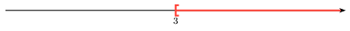</summary>

```typ
#rep-intervalles(
  xmin: 0, xmax: 6,
  valeurs: (3,),
  ctz-intervalle(
    3, "*", type: "FO",
  ),
)
```

</details>

<details>
<summary>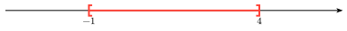</summary>

```typ
#rep-intervalles(
  xmin: -3, xmax: 6,
  valeurs: (-1, 4),
  ctz-intervalle(
    -1, 4,
  ),
)
```

</details>

<details>
<summary>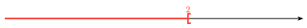</summary>

```typ
#rep-intervalles(
  xmin: -3, xmax: 5,
  ctz-intervalle(
    "*", 2, type: "OO",
    aff-valeurs: true,
  ),
)
```

</details>

<details>
<summary></summary>

```typ
#rep-intervalles(
  xmin: -2, xmax: 7,
  ctz-intervalle(
    0, 5, type: "OF",
    aff-valeurs: true, pos-valeurs: "below",
  ),
)
```

</details>

### 2. Les quatre types de crochets

<details>
<summary>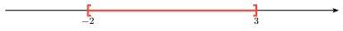</summary>

```typ
#rep-intervalles(
  xmin: -4, xmax: 5,
  valeurs: (-2, 3),
  ctz-intervalle(
    -2, 3, type: "FF",
  ),
)
```

</details>

<details>
<summary>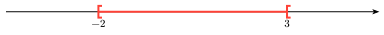</summary>

```typ
#rep-intervalles(
  xmin: -4, xmax: 5,
  valeurs: (-2, 3),
  ctz-intervalle(
    -2, 3, type: "FO",
  ),
)
```

</details>

<details>
<summary></summary>

```typ
#rep-intervalles(
  xmin: -4, xmax: 5,
  valeurs: (-2, 3),
  ctz-intervalle(
    -2, 3, type: "OF",
  ),
)
```

</details>

<details>
<summary>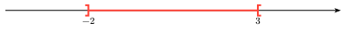</summary>

```typ
#rep-intervalles(
  xmin: -4, xmax: 5,
  valeurs: (-2, 3),
  ctz-intervalle(
    -2, 3, type: "OO",
  ),
)
```

</details>

### 3. Bornes infinies

<details>
<summary>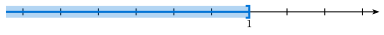</summary>

```typ
#rep-intervalles(
  xmin: -5, xmax: 4,
  graduations: range(-5, 5),
  valeurs: (1,),
  ctz-intervalle(
    "*", 1, type: "OF",
    couleur: blue, decor: "fond",
  ),
)
```

</details>

<details>
<summary>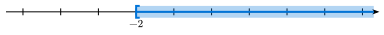</summary>

```typ
#rep-intervalles(
  xmin: -5, xmax: 4,
  graduations: range(-5, 5),
  valeurs: (-2,),
  ctz-intervalle(
    -2, "*", type: "FO",
    couleur: blue, decor: "fond",
  ),
)
```

</details>

<details>
<summary>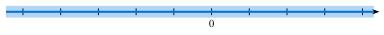</summary>

```typ
#rep-intervalles(
  xmin: -5, xmax: 4,
  graduations: range(-5, 5),
  valeurs: (0,),
  ctz-intervalle(
    "*", "*", type: "OO",
    couleur: blue, decor: "fond",
  ),
)
```

</details>

<details>
<summary>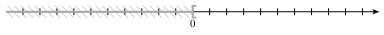</summary>

```typ
#rep-intervalles(
  xmin: -10, xmax: 10,
  graduations: range(-10, 11),
  valeurs: (0,),
  longueur: 12,
  ctz-intervalle(
    "*", 0, type: "OO",
    couleur: gray, decor: "hach/135",
  ),
)
```

</details>

### 4. Décorations

<details>
<summary></summary>

```typ
#rep-intervalles(
  xmin: -1, xmax: 6,
  valeurs: (1, 4),
  ctz-intervalle(
    1, 4,
    couleur: teal, decor: "fond",
  ),
)
```

</details>

<details>
<summary></summary>

```typ
#rep-intervalles(
  xmin: -1, xmax: 6,
  valeurs: (1, 4),
  ctz-intervalle(
    1, 4,
    couleur: purple, decor: "zigzag",
  ),
)
```

</details>

<details>
<summary>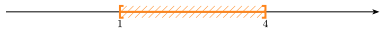</summary>

```typ
#rep-intervalles(
  xmin: -1, xmax: 6,
  valeurs: (1, 4),
  ctz-intervalle(
    1, 4,
    couleur: orange, decor: "hach",
  ),
)
```

</details>

<details>
<summary>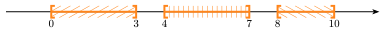</summary>

```typ
#rep-intervalles(
  xmin: -1, xmax: 11,
  valeurs: (0, 3, 4, 7, 8, 10),
  ctz-intervalle(
    0, 3,
    couleur: orange, decor: "hach/30",
  ),
  ctz-intervalle(
    4, 7,
    couleur: orange, decor: "hach/90",
  ),
  ctz-intervalle(
    8, 10,
    couleur: orange, decor: "hach/150",
  ),
)
```

</details>

### 5. Graduations

<details>
<summary></summary>

```typ
#rep-intervalles(
  xmin: -5, xmax: 5,
  graduations: range(-5, 6),
  ctz-intervalle(
    -2, 3, type: "FO",
    aff-valeurs: true,
  ),
)
```

</details>

<details>
<summary></summary>

```typ
#rep-intervalles(
  xmin: 0, xmax: 20,
  graduations: range(0, 21),
  graduations-alt: range(0,5).map(k => k*5),
  valeurs: (0, 5, 10, 15, 20),
  ctz-intervalle(
    7, 13, type: "OF",
    couleur: blue, decor: "fond", aff-valeurs: true,
  ),
)
```

</details>

### 6. Valeurs

<details>
<summary></summary>

```typ
#rep-intervalles(
  xmin: -5, xmax: 5,
  graduations: range(-5, 6),
  valeurs: range(-5, 6),
  ctz-intervalle(
    -2, 3, type: "FO",
  ),
)
```

</details>

<details>
<summary></summary>

```typ
#rep-intervalles(
  xmin: 0, xmax: 3,
  graduations: range(0, 7).map(k => k / 2),
  valeurs: range(0, 7).map(k => k / 2),
  ctz-intervalle(
    0.5, 2.5, type: "FO",
  ),
)
```

</details>

<details>
<summary>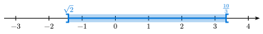</summary>

```typ
#rep-intervalles(
  xmin: -3, xmax: 4,
  graduations: range(-3, 5), 
  valeurs: range(-3,5),
  ctz-intervalle(
    -calc.sqrt(2), 10/3, type: "OO",
    couleur: blue, decor: "fond",
    aff-valeurs: true, label-inf: $sqrt(2)$, label-sup: $10/3$
  ),
)
```

</details>

<details>
<summary></summary>

```typ
#rep-intervalles(
  xmin: 0, xmax: 10,
  ctz-intervalle(
    2, 7,
    decor: "fond", aff-valeurs: true, pos-valeurs: "below",
    label-inf: $a$, label-sup: $b$,
  ),
)
```

</details>

<details>
<summary>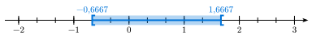</summary>

```typ
#rep-intervalles(
  xmin: -2, xmax: 3,
  graduations: range(-6, 10).map(k => k / 3),
  graduations-alt: range(-2, 4),
  valeurs: range(-2, 4),
  ctz-intervalle(
    -2/3, 5/3, type: "FO",
    couleur: blue, decor: "fond",
    aff-valeurs: true, 
  ),
)
```

</details>

<details>
<summary>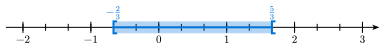</summary>

```typ
#rep-intervalles(
  xmin: -2, xmax: 3,
  graduations: range(-6, 10).map(k => k / 3),
  graduations-alt: range(-2, 4),
  valeurs: range(-2, 4),
  ctz-intervalle(
    -2/3, 5/3, type: "FO",
    couleur: blue, decor: "fond",
    aff-valeurs: true, label-inf: $-2/3$, label-sup: $5/3$,
  ),
)
```

</details>

### 7. Plusieurs intervalles

<details>
<summary></summary>

```typ
#rep-intervalles(
  xmin: -4, xmax: 5,
  graduations: range(-4, 6),
  valeurs: (-1, 2),
  ctz-intervalle(
    "*", -1, type: "OF",
    couleur: blue, decor: "hach",
  ),
  ctz-intervalle(
    2, "*", type: "FO",
    couleur: blue, decor: "hach",
  ),
)
```

</details>

<details>
<summary>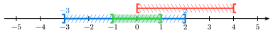</summary>

```typ
#rep-intervalles(
  xmin: -5, xmax: 5,
  graduations: range(-5, 6),
  valeurs: range(-5, 6),
  ctz-intervalle(
    -3, 2, type: "OF",
    couleur: blue, decor: "hach/60",
    aff-valeurs: true,
  ),
  ctz-intervalle(
    0, 4, type: "FO",
    couleur: red, niveau-v: 1.25, decor: "hach/120",
  ),
  ctz-intervalle(
    -1, 1, type: "OF",
    couleur: green, decor: "fond",
  ),
)
```

</details>

<details>
<summary>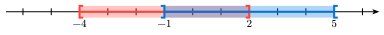</summary>

```typ
#rep-intervalles(
  xmin: -6, xmax: 6,
  graduations: range(-6, 7),
  valeurs: (-4, -1, 2, 5),
  ctz-intervalle(
    -4, 2,
    couleur: red, decor: "fond",
  ),
  ctz-intervalle(
    -1, 5, type: "OO",
    couleur: blue, decor: "fond",
  ),
)
```

</details>

### 8. Les exemples de la doc de ProfLycee (§13, p. 55 à 58)

<details>
<summary></summary>

```typ
#rep-intervalles(
  xmin: -8, xmax: 20,
  ctz-intervalle(
    "*", 13,
  ),
)
```

</details>

<details>
<summary></summary>

```typ
#rep-intervalles(
  xmin: -2, xmax: 8,
  unite: 1cm,
  graduations: range(-2, 9),
  graduations-alt: (0, 5),
)
```

</details>

<details>
<summary></summary>

```typ
#rep-intervalles(
  xmin: -100, xmax: 200,
  longueur: 10, police: (size: 7pt), ep-trait: 0.6pt,
  graduations: range(-100, 201, step: 10),
  graduations-alt: range(-100, 201, step: 50),
  valeurs: range(-100, 201, step: 50),
  ctz-intervalle(
    -15, 175,
    aff-valeurs: true,
  ),
  ctz-intervalle(
    -56, 25,
    couleur: teal, decor: "fond",
    aff-valeurs: true,
  ),
  ctz-intervalle(
    0, 79, type: "OO",
    couleur: purple, decor: "zigzag", niveau-v: 1.5,
    aff-valeurs: true,
  ),
)
```

</details>

<details>
<summary>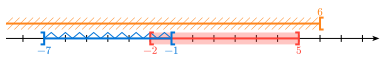</summary>

```typ
#rep-intervalles(
  xmin: -8, xmax: 8,
  graduations: range(-8, 9),
  ctz-intervalle(
    -2, 5,
    decor: "fond",
    aff-valeurs: true, pos-valeurs: "below",
  ),
  ctz-intervalle(
    -7, -1, type: "OO",
    couleur: blue, decor: "zigzag",
    aff-valeurs: true, pos-valeurs: "below",
  ),
  ctz-intervalle(
    "*", 6, type: "FO",
    couleur: orange, decor: "hach", niveau-v: 1.25,
    aff-valeurs: true,
  ),
)
```

</details>

<details>
<summary>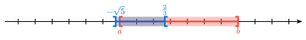</summary>

```typ
#rep-intervalles(
  xmin: -8, xmax: 8,
  graduations: range(-8, 9),
  ctz-intervalle(
    -2, 5,
    decor: "fond",
    aff-valeurs: true, pos-valeurs: "below",
    label-inf: $a$, label-sup: $b$,
  ),
  ctz-intervalle(
    -calc.sqrt(5), 2 / 3, type: "OO",
    couleur: blue, decor: "fond",
    aff-valeurs: true,
    label-inf: $-sqrt(5)$, label-sup: $2/3$,
  ),
)
```

</details>
<!-- fin des exemples -->

## Les clés

La fonction `rep-intervalles(clés, …)` dessine l'axe et les `ctz-intervalle(…)` qu'on y
met. La fonction `rep-intervalles-dessin`
prend les mêmes clés, mais donne les éléments CeTZ seuls, à mettre dans son
propre `cetz.canvas` (importer alors CeTZ : `#import "@preview/cetz:0.5.2"`).

### Clés de `rep-intervalles`

| Clé | Défaut | Rôle |
|---|---|---|
| `xmin`, `xmax` | `-8`, `8` | bornes de l'axe |
| `longueur` | `12` | longueur de l'axe de `xmin` à `xmax`, en cm |
| `unite` | `auto` | longueur d'une unité (`1cm`) ; `auto` : d'après `longueur` |
| `graduations` | `()` | abscisses des graduations |
| `graduations-alt` | `()` | abscisses des grandes graduations |
| `valeurs` | `()` | nombres écrits sous l'axe |
| `haut-grad` | `7pt` | hauteur d'une graduation |
| `hauteur` | `12pt` | hauteur des intervalles (crochets, décoration) |
| `ep-trait` | `1pt` | épaisseur des traits |
| `police` | `(:)` | réglages du texte, comme `(size: 8pt)` |


### Clés de `ctz-intervalle`

`ctz-intervalle(inf, sup, clés)` : une borne infinie s'écrit `"*"` (ou
`none`) ; les autres sont des nombres Typst (`0`, `2 / 3`, `calc.sqrt(5)`),
pas du texte (`"0"`) ni des maths (`$sqrt(5)$`).

| Clé | Défaut | Rôle |
|---|---|---|
| `type` | `"FF"` | crochets : `"FF"`, `"FO"`, `"OF"` ou `"OO"` (F fermé, O ouvert) |
| `couleur` | `red` | couleur |
| `decor` | `none` | `"fond"`, `"zigzag"`, `"hach"` ou `"hach/<angle>"` (angle non horizontal, `"hach"` : 45°) |
| `niveau-v` | `0` | hauteur, en hauteurs d'intervalle (`1.25` : au-dessus de l'axe) |
| `aff-valeurs` | `false` | écrire les bornes |
| `pos-valeurs` | `"above"` | au-dessus (`"above"`) ou en dessous (`"below"`) |
| `label-inf`, `label-sup` | `auto` | étiquettes des bornes, comme `$-sqrt(5)$` |
| `num-inf`, `num-sup` | `true` | `false` : bornes écrites telles quelles, sans virgule |

## Licence

MIT. Réécriture indépendante d'après la documentation de ProfLycee (rendu,
noms des clés), sans reprise de son code (LPPL).
